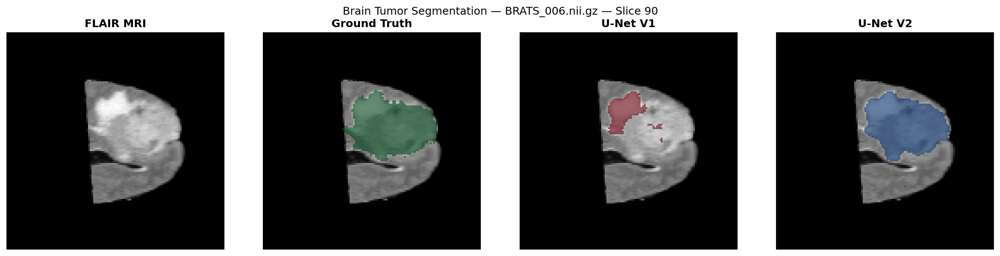
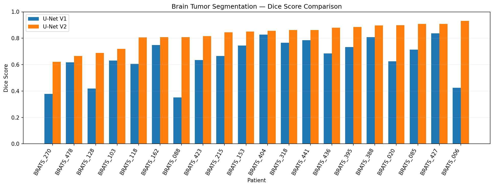

# Brain Tumor Segmentation using U-Net 2D

Deep learning project for automatic brain tumor segmentation from MRI scans using PyTorch and MONAI.

## Overview

This project implements and evaluates a 2D U-Net for binary brain tumor segmentation using FLAIR MRI sequences.

The objective is to develop a reproducible medical image segmentation pipeline and assess the effect of additional training data and optimization.

## Dataset

**Medical Segmentation Decathlon — Task01 BrainTumour**

- 484 annotated training MRI volumes
- MRI modalities: FLAIR, T1, T1ce and T2
- Original image dimensions: 240 × 240 × 155
- Binary segmentation: tumor versus background

Only FLAIR is used for the current model.

Dataset: https://medicaldecathlon.com/

## Methodology

- Loading and preprocessing 3D MRI volumes using NiBabel
- Slice-wise intensity normalization
- Resizing 2D slices to 128 × 128
- Patient-level train/validation separation
- 2D U-Net implemented with MONAI and PyTorch
- Combined Dice and Binary Cross-Entropy loss
- Adam optimizer and GPU training
- Patient-level Dice Score evaluation

## Experiments

Two model configurations were evaluated:

**U-Net V1**
- 28 training patients
- 5 epochs
- FLAIR input

**U-Net V2**
- Fine-tuning from V1
- 120 training patients
- 10 additional epochs
- FLAIR input

## Results

Evaluation on 20 held-out annotated patients:

| Model | Mean Dice Score |
|---|---:|
| U-Net V1 | 0.6502 |
| U-Net V2 | **0.8261** |

**Absolute Dice improvement: +0.1759**

The results correspond to binary tumor segmentation on resized FLAIR MRI slices. They do not represent clinical validation.

## Technologies

Python, PyTorch, MONAI, NiBabel, NumPy, Scikit-learn, Matplotlib, CUDA.

## Repository Structure

- `notebooks/`: experimentation and model training
- `src/`: reusable Python scripts
- `results/`: quantitative evaluation results
- `models/`: local model checkpoints (excluded from Git)

## Limitations

- Binary segmentation rather than individual tumor subregions
- Only FLAIR MRI used for training
- Limited evaluation cohort
- 2D models do not explicitly use inter-slice spatial context

## Disclaimer

This project is intended for educational and research purposes only and is not a medical diagnostic tool.

## Visual Results

### Segmentation Predictions — U-Net V1 vs V2

Comparison of the original FLAIR MRI, ground-truth annotation,
and tumor segmentation predictions from both models.

### Quantitative Evaluation — Dice Score

Comparison of U-Net V1 and U-Net V2 on 20 held-out MRI volumes.

